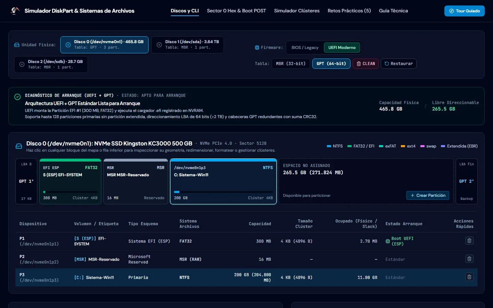
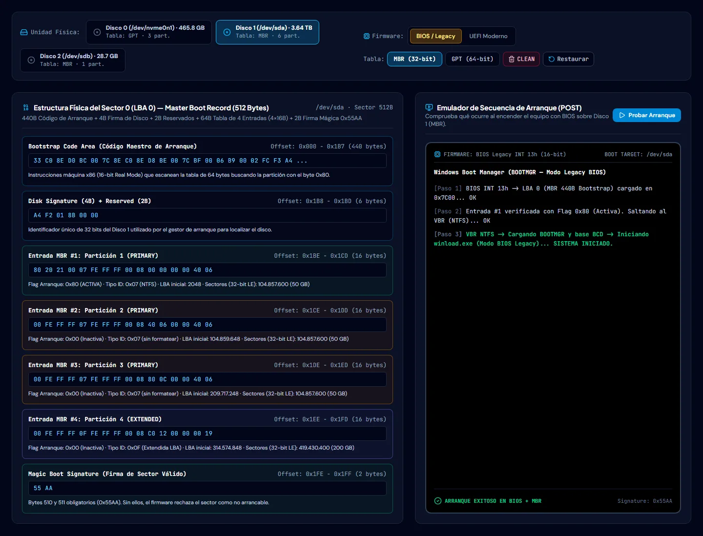
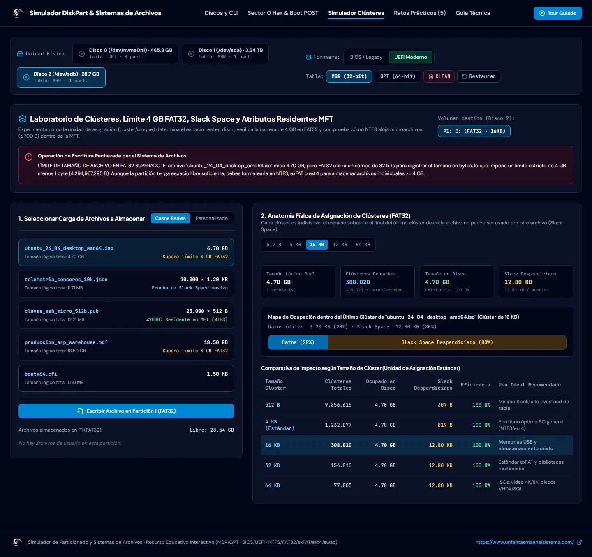
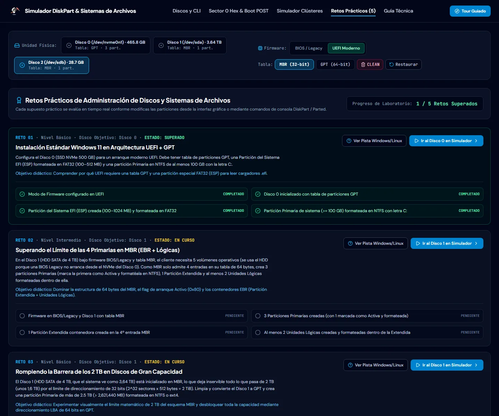

<p align="center">
  <a href="https://www.unfantasmaenelsistema.com"></a>
</p>

<h1 align="center">Simulador de Particionado y Sistemas de Archivos</h1>

<p align="center">
  <b>Particiona, formatea y arranca discos virtuales con DiskPart y sus equivalentes de Linux</b><br>
  MBR y GPT · BIOS/Legacy y UEFI · Sector 0 en hexadecimal · NTFS, FAT32, exFAT, ext4 y swap · Clústeres y slack · 5 retos autoevaluables
</p>

<p align="center">
  <a href="https://unfantasmaenelsistema.github.io/Simulador-Particionado-y-Sistemas-de-Archivos/"><b>▶ Abrir el simulador</b></a> ·
  <a href="#qué-hace">Qué hace</a> ·
  <a href="#para-clase">Para clase</a> ·
  <a href="#qué-modela-y-qué-no">Qué modela</a> ·
  <a href="#desarrollo">Desarrollo</a> ·
  <a href="https://www.unfantasmaenelsistema.com">unfantasmaenelsistema.com</a> ·
  <a href="LICENSE">MIT</a>
</p>

<p align="center">
  
  
  
  
</p>

<p align="center">
  
</p>

Tres discos virtuales (un NVMe de 500 GB, un HDD SATA de 4 TB y un pendrive de 32 GB) para practicar todo el ciclo: inicializar en MBR o GPT, crear particiones primarias, extendidas, lógicas, EFI y MSR, formatearlas con distintos tamaños de clúster y comprobar si el equipo arranca con BIOS o con UEFI. Cada acción de la interfaz se traduce a su comando de DiskPart y a su equivalente en Linux (`parted`, `mkfs`, `mkswap`), y también se pueden escribir los comandos a mano en la consola.

> [!NOTE]
> Es un modelo didáctico: no toca ningún disco real. Las estructuras (tabla MBR de 64 bytes, cabecera GPT, GUID de tipo, límites de FAT32, NTFS, exFAT y ext4) son las reales; la ocupación de metadatos de cada sistema de archivos es una aproximación.

## Qué hace

- **Discos y consola DiskPart**: `list disk`, `select`, `detail`, `clean`, `convert mbr|gpt`, `create partition primary|extended|logical|efi|msr`, `format fs=… unit=… label=…`, `shrink`, `extend`, `active`, `assign` y `delete`, con su equivalente de Linux debajo de cada comando.
- **Capacidad real**: el disco «de 500 GB» aparece como 465,8 GB y el de 4 TB como 3,64 TB, porque el fabricante cuenta en base 10 y el sistema en base 2. `detail disk` muestra las dos cifras.
- **Diagnóstico de arranque** para cada combinación: BIOS + MBR (partición activa y VBR), UEFI + GPT (ESP en FAT32 y volumen del sistema), BIOS + GPT, UEFI + MBR y BIOS sobre un NVMe.
- **Sector 0 en hexadecimal**: código de arranque, firma de disco, las 4 entradas de 16 bytes con flag 0x80, CHS, tipo, LBA de inicio y número de sectores calculados de verdad, y la firma 0x55AA; en GPT, el MBR protector 0xEE, la cabecera «EFI PART» y los GUID de tipo de cada partición.
- **Laboratorio de clústeres**: espacio en disco frente a tamaño lógico, slack space, archivos residentes en la MFT de NTFS y el límite de 4 GB por archivo de FAT32.
- **Validaciones con explicación**: 4 primarias o 3 + extendida en MBR, barrera de 2 TiB, 128 entradas en GPT, FAT32 con su mínimo de 65.525 clústeres, ext4 sin bloques de 512 B, letras de unidad que no se repiten.
- **Cinco retos autoevaluables** y un **tour guiado** que aparece la primera vez.

<p align="center">
  
</p>

## Para clase

| Reto | Disco | Qué se practica |
| :-- | :-- | :-- |
| 01 · Windows 11 en UEFI + GPT | NVMe | ESP en FAT32, MSR y volumen NTFS con letra C: |
| 02 · Más de 4 particiones en MBR | HDD SATA | 3 primarias (una activa), extendida y 2 lógicas con BIOS Legacy |
| 03 · La barrera de los 2 TB | HDD SATA | Pasar de MBR a GPT para usar toda la capacidad |
| 04 · El error de los 4 GB | Pendrive | Una ISO de 4,7 GB no cabe en FAT32: exFAT o NTFS con clúster de 64 KB |
| 05 · Arranque dual | NVMe | ESP compartida, NTFS para Windows, ext4 y swap para Linux |

Cada reto tiene su pista con los comandos de DiskPart y de Linux; las pruebas automáticas del repositorio ejecutan esas pistas y comprueban que completan el reto. El botón **Restaurar** devuelve los tres discos a su estado inicial.

<p align="center">
  
</p>

## Qué modela y qué no

- La BIOS Legacy no arranca desde NVMe (salvo placas con una Option ROM específica), así que el reto de MBR + BIOS se hace en el HDD SATA.
- UEFI puede arrancar desde MBR con una partición 0xEF; el simulador lo explica, pero trata ese caso como no apto porque el escenario es la instalación de Windows, que en UEFI exige GPT.
- DiskPart real no formatea ext4 ni swap: el simulador lo permite para practicar el arranque dual y lo indica junto al comando de Linux equivalente.
- Al reducir o eliminar una partición, las siguientes se recolocan a continuación; un disco real dejaría el hueco donde estaba.

## Privacidad

Todo se ejecuta en el navegador, sin servidor ni cuentas. Solo se guarda en el propio navegador que el tour ya se ha visto. Las fuentes van incluidas en la web y una política CSP estricta impide cargar código o estilos de terceros.

## Desarrollo

Requisitos: Node.js 20 o superior.

```bash
git clone https://github.com/unfantasmaenelsistema/Simulador-Particionado-y-Sistemas-de-Archivos.git
cd Simulador-Particionado-y-Sistemas-de-Archivos
npm ci
npm run dev      # http://localhost:3000
npm test         # pruebas del motor de discos (Vitest)
npm run lint     # comprobación de tipos
npm run build    # versión estática en dist/
```

El workflow `.github/workflows/deploy.yml` comprueba tipos, pasa las pruebas, compila y publica `dist/` en GitHub Pages en cada push a `main`.

```text
src/
├── types/storage.ts           # tipos, límites y especificaciones de cada sistema de archivos
├── utils/diskEngine.ts        # discos, DiskPart, validaciones, arranque, hex del sector 0 y retos
├── utils/diskEngine.test.ts
└── components/                # mapa del disco, consola, hex y arranque, clústeres, retos, guía y tour
```

<p align="center">
  
</p>

## Cambios

### 2.0.0 (2026-11-01)

- Publicado en la organización con despliegue en GitHub Pages: el workflow original no podía funcionar (`npm install` fallaba por un conflicto de versiones de `esbuild` y la caché de npm no tenía lockfile).
- **Identificadores de partición únicos**: se generaban con la hora en milisegundos y dos particiones creadas seguidas (pistas, tour) compartían id, de modo que el formato se aplicaba a la que no era. La pista del reto 5 acababa con ext4 y swap en la misma partición.
- **Hex del sector 0**: las cuatro entradas MBR tenían siempre la misma LBA de inicio (2048) y el mismo CHS; ahora se calculan para cada partición.
- **Arranque**: la BIOS Legacy ya no arranca desde el NVMe; el reto 2 pasa al HDD SATA. El caso UEFI + MBR explica que la especificación sí lo admite y que es Windows quien exige GPT.
- **Capacidades reales**: 465,8 GB, 3,64 TB y 28,7 GB en lugar de cifras redondas en base 2, con la capacidad comercial en `detail disk`.
- **Lógicas** numeradas desde 5 (sda5, sda6) y colocadas dentro de la extendida.
- **Formato**: FAT32 exige entre 65.525 y 268.435.445 clústeres, ext4 no admite bloques de 512 B, `format` ya no pone la letra F: a todas las particiones y `assign` no repite letras. El límite de archivo de NTFS estaba mal (8 PB requiere clústeres de 2 MB, no de 64 KB).
- **Interfaz**: si al crear una partición falla el formato, el formulario lo explica en lugar de cerrarse. En el móvil la página se salía por la derecha y el tour inicial no se podía cerrar; ahora se adapta y solo aparece la primera vez. El registro inicial de la consola se calcula con el propio motor.
- Fuentes incluidas en la web en lugar de Google Fonts, CSP estricta, fuera dependencias de Gemini y Express que no se usaban y la carpeta `.aistudio` subida por error, y 18 pruebas automáticas del motor.

### 1.0.0

- Versión inicial generada con Google AI Studio.

## Créditos y licencia

Creado por **[Un Fantasma en el Sistema](https://www.unfantasmaenelsistema.com)** para los módulos de sistemas operativos y montaje de equipos de FP. Fuentes DM Sans, Plus Jakarta Sans y JetBrains Mono (SIL Open Font License) vía Fontsource; iconos de Lucide (ISC).

Código bajo licencia [MIT](LICENSE).
