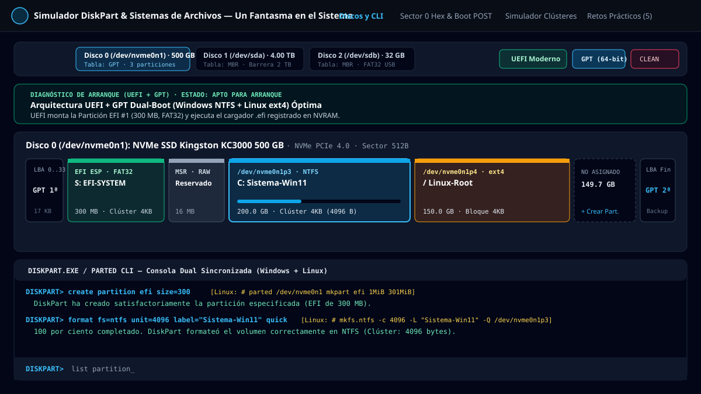
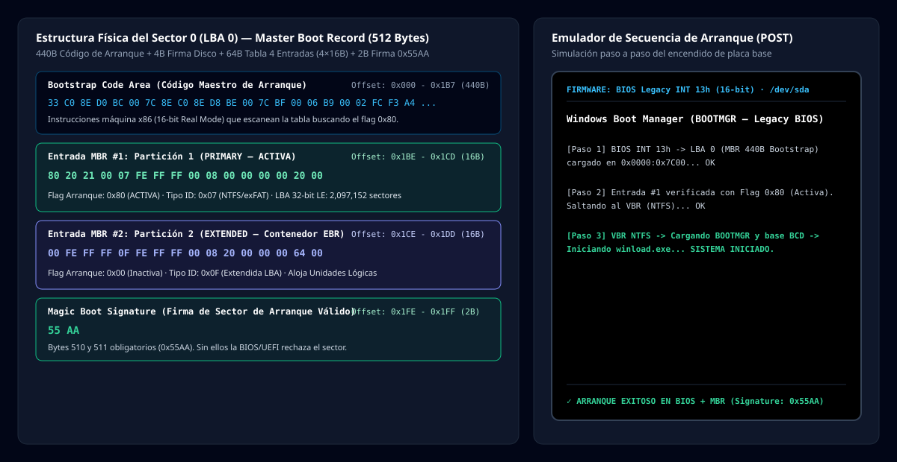
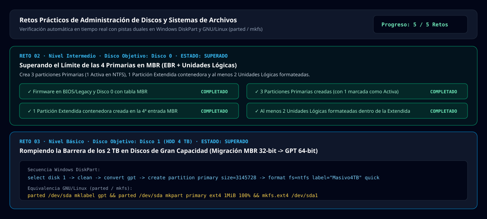

<div align="center">
  <a href="https://www.unfantasmaenelsistema.com/" target="_blank" rel="noopener noreferrer">
    
  </a>

  # Simulador de Particionado y Sistemas de Archivos
  ### Laboratorio Didáctico Interactivo: MBR vs. GPT · BIOS/Legacy vs. UEFI · NTFS, FAT32, exFAT, ext4 y Swap · Consola DiskPart / Parted

  [**🌐 Un Fantasma en el Sistema (https://www.unfantasmaenelsistema.com/)**](https://www.unfantasmaenelsistema.com/)
</div>

---

## 📖 Descripción General

El **Simulador de Particionado y Sistemas de Archivos** es una herramienta interactiva de grado educativo y técnico diseñada para estudiantes y profesionales de **Sistemas Microinformáticos y Redes (SMR)**, **Administración de Sistemas Informáticos en Red (ASIR)** y **Desarrollo de Aplicaciones (DAM/DAW)**.

Recrea en tiempo real tanto una interfaz visual de bloques al estilo **GParted / Administración de Discos de Windows** como una consola interactiva sincronizada **`DISKPART.EXE`** con traducción inmediata a utilidades **GNU/Linux (`parted`, `fdisk`, `lsblk`, `mkfs`)**.

---

## 🖼️ Capturas del Simulador

### 1. Administrador Visual de Discos (GParted / Disk Management) y Consola `DISKPART>` Sincronizada


### 2. Inspector Hexadecimal en Tiempo Real (Sector 0 MBR / Cabecera GPT) y Emulador de Arranque POST


### 3. Simulador de Clústeres, Límite de 4 GB en FAT32, Slack Space y Atributos Residentes MFT (NTFS)


### 4. Laboratorio de Retos Prácticos Autoevaluables en Vivo


---

## ⚙️ Mecánica Didáctica y Características Técnicas

### 1. Tablas de Particiones: MBR (Master Boot Record) vs. GPT (GUID Partition Table)
- **Límite de las 4 Particiones Primarias en MBR**: Reproduce fielmente la estructura de **64 bytes** ($4 \times 16\text{ bytes}$) de la tabla de particiones en el Sector 0 (`0x1BE - 0x1FD`). Para crear más de 4 volúmenes en MBR, el alumno debe crear una **Partición Extendida (`0x0F`)** y alojar **Unidades Lógicas** en su interior mediante registros EBR encadenados.
- **Barrera Matemática de los 2 TB en MBR**: En el **Disco 1 (HDD SATA de 4 TB)**, cuando está inicializado en MBR con sectores de 512 bytes, el direccionamiento LBA de 32 bits ($2^{32} \times 512\text{ B} = 2\text{ TB}$) bloquea visual y funcionalmente los 2 TB superiores hasta que el alumno convierte el disco a **GPT (LBA de 64 bits)**.
- **Arquitectura GPT**: Soporta hasta **128 particiones primarias** sin necesidad de partición extendida, incluye el **Protective MBR (`0xEE`)** en LBA 0, la cabecera primaria **`EFI PART`** en LBA 1 con verificación CRC32 y la copia de seguridad secundaria al final del disco.

### 2. Esquemas de Arranque: BIOS / Legacy (CSM) vs. UEFI Moderno
- **Diagnóstico en Tiempo Real y Emulador POST**:
  - **BIOS / Legacy + MBR**: Requiere exactamente una partición Primaria marcada como **Activa (`0x80`)** con un VBR (*Volume Boot Record*) formateado.
  - **UEFI + GPT**: Exige una **Partición del Sistema EFI (ESP)** con GUID `C12A7328-F81F-11D2-BA4B-00A0C93EC93B` formateada obligatoriamente en **FAT32** para que el firmware de la placa base pueda montar y ejecutar `bootmgfw.efi` o `grubx64.efi`.
  - **Cruces incompatibles (`UEFI + MBR` o `BIOS + GPT`)**: Reproduce los mensajes de error reales del instalador de Windows y de la BIOS/UEFI.

### 3. Sistemas de Archivos (`NTFS`, `FAT32`, `exFAT`, `ext4`, `swap`) y Matemática de Clústeres
- **Límite de Tamaño de Archivo de 4 GB en FAT32**: Intentar guardar la imagen ISO `ubuntu_24_04_desktop_amd64.iso` (**4.70 GB**) en un volumen FAT32 dispara el error real de desbordamiento del campo de 32 bits ($2^{32} - 1 = 4,294,967,295\text{ bytes}$), aun cuando el pendrive tenga 32 GB libres.
- **Cálculo de Fragmentación Interna (Slack Space)**:
  $$\text{Clústeres Ocupados} = N_{\text{archivos}} \times \left\lceil \frac{\text{Tamaño Archivo (Bytes)}}{\text{Tamaño Clúster (Bytes)}} \right\rceil$$
  $$\text{Slack Space} = (\text{Clústeres Ocupados} \times \text{Tamaño Clúster}) - \text{Tamaño Lógico Total}$$
- **Atributos Residentes en la MFT de NTFS ($\le 700\text{ B}$)**: Muestra cómo NTFS almacena los microarchivos directamente dentro del registro de 1 KB de la *Master File Table* (`$DATA` residente), ocupando **0 clústeres externos y 0 bytes de Slack Space**.

---

## 💻 Comandos Soportados en la Consola Interactiva `DISKPART>`

| Comando DiskPart / Linux | Descripción |
| :--- | :--- |
| `list disk` / `fdisk -l` | Lista todos los discos físicos conectados (`/dev/nvme0n1`, `/dev/sda`, `/dev/sdb`). |
| `select disk <0\|1\|2>` | Selecciona la unidad física activa. |
| `detail disk` | Muestra geometría física, sectores LBA totales y capacidad direccionable. |
| `clean` / `wipefs -a` | Elimina todas las particiones y deja el disco sin inicializar (`RAW`). |
| `convert mbr` / `convert gpt` | Inicializa o convierte el esquema de particiones del disco entre MBR y GPT. |
| `list partition` / `lsblk` | Lista las particiones del disco activo con su punto de montaje y tamaño de clúster. |
| `select partition <N>` | Selecciona la partición número `N` del disco actual. |
| `detail partition` | Inspecciona el GUID/ID hexadecimal, offset LBA, clúster y consumo físico/Slack. |
| `filesystems` | Muestra la tabla técnica de sistemas de archivos soportados. |
| `create partition primary [size=<MB>]` | Crea una partición primaria en MBR o GPT. |
| `create partition efi [size=<MB>]` | Crea una Partición del Sistema EFI (ESP) en discos GPT. |
| `create partition msr [size=<MB>]` | Crea una Partición Reservada de Microsoft (MSR, 16 MB) en discos GPT. |
| `create partition extended [size=<MB>]` | Crea una Partición Extendida contenedora en discos MBR. |
| `create partition logical [size=<MB>]` | Crea una Unidad Lógica dentro de la Partición Extendida en MBR. |
| `shrink desired=<MB>` | Reduce el tamaño del volumen seleccionado liberando espacio no asignado. |
| `extend [size=<MB>]` | Amplía el volumen seleccionado utilizando espacio no asignado contiguo. |
| `format fs=<ntfs\|fat32\|exfat\|ext4\|swap> [unit=<512..65536>] [label="..."] [quick]` | Formatea la partición con el sistema de archivos y tamaño de clúster indicados. |
| `active` / `inactive` | Activa o desactiva el flag de arranque MBR (`0x80`) en una partición primaria. |
| `assign letter=<C..Z>` | Asigna letra de unidad o punto de montaje Linux (`/`, `/boot/efi`). |
| `delete partition` | Elimina la partición seleccionada. |

---

## 🚀 Instalación Local y Despliegue en GitHub Pages

### 1. Ejecución en entorno local
```bash
# 1. Clonar el repositorio
git clone https://github.com/TU_USUARIO/TU_REPOSITORIO.git
cd TU_REPOSITORIO

# 2. Instalar dependencias
npm install

# 3. Iniciar servidor de desarrollo (http://localhost:3000)
npm run dev

# 4. Compilar versión estática de producción en ./dist
npm run build
```

### 2. Despliegue automático en GitHub Pages (Ya preconfigurado)
Este proyecto incluye configuración de rutas relativas (`base: './'` en `vite.config.ts`), archivo `.nojekyll` y el flujo de trabajo oficial de **GitHub Actions** en `.github/workflows/deploy.yml`:

1. Sube este código a un repositorio en tu cuenta de **GitHub** (rama `main` o `master`).
2. En tu repositorio de GitHub, entra en **Settings** $\rightarrow$ **Pages** (en el menú lateral izquierdo).
3. En la sección **Build and deployment** $\rightarrow$ **Source**, selecciona **GitHub Actions**.
4. El workflow **Deploy to GitHub Pages** se ejecutará automáticamente y publicará la aplicación en:
   `https://<tu-usuario>.github.io/<nombre-del-repositorio>/`

---

## 👻 Autoría y Recursos Didácticos

Desarrollado para [**Un Fantasma en el Sistema**](https://www.unfantasmaenelsistema.com/).
Visita la web oficial para más simuladores, artículos técnicos y laboratorios de sistemas y ciberseguridad:
👉 **[https://www.unfantasmaenelsistema.com/](https://www.unfantasmaenelsistema.com/)**
